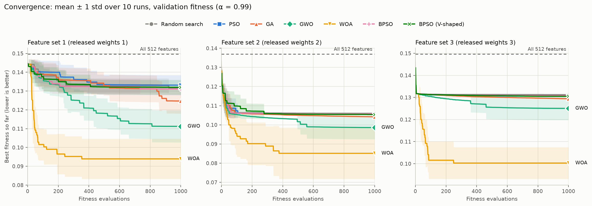
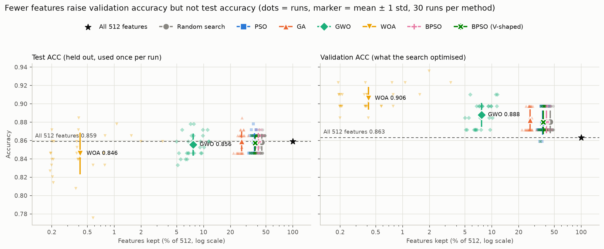

# Bio-Inspired Feature Selection Does Not Improve Deep-Feature Classification of BreastMNIST: A Controlled Negative Result

> **Draft — 1 Nov 2026.** Every number comes from the generated outputs listed in §11. Designs for Studies B–D were written into `docs/project_context.md` (steps 12–14) before their test data were scored; the one later design change is disclosed in §6.2.

---

## Abstract

Bio-inspired metaheuristics are widely used to select subsets of deep features for medical image classification, usually with reported accuracy gains. We tested whether such gains hold under strict controls on BreastMNIST (780 breast-ultrasound images, binary malignant vs. non-malignant). The controls were:

- equal evaluation budgets for every method;
- a random-search control with the same budget;
- seeds paired across methods;
- test data used once per design;
- correction for multiple comparisons, including a corrected resampled t-test for repeated cross-validation;
- designs fixed before scoring.

Four studies were run:

- **A:** PSO, GA, GWO, WOA and two binary-PSO variants on the 512 features of the released MedMNIST v2 ResNet-18, which reproduce the published scores exactly (AUC 0.901, ACC 0.863);
- **B:** the same features, with every method restricted to exactly 10, 20 or 40 features;
- **C:** features from a frozen ImageNet-pretrained ResNet-18, evaluated by nested cross-validation over all 780 images;
- **D:** as C, with exactly 20 features.

Across 1,260 search runs, **no bio-inspired method was significantly better than random search on any test metric in any study**. None was significantly better than using all features either.

The algorithms do optimise their fitness better than random search. In Study C, GA and GWO raised inner-CV accuracy to 0.879–0.880 against 0.858 for random search and 0.842 for all features. That advantage did not carry over to held-out data: test accuracy was 0.845–0.849 for every method.

Two mechanisms explain the null results. On the task-trained features, the 512 dimensions are so redundant that a single random 10-feature subset reaches test accuracy 0.855 against 0.859 for all 512. On generic features, where selection does have room to help, the searches fit the particular data split used to score them (selection bias). The only feature-selection result we can support is a reduction in feature count at equal accuracy. In Study A, GWO kept 7.9% of features and GA 26.9%, with no significant loss in test accuracy. Random search already halves the feature count on its own.

---

## 1. Introduction

MedMNIST v2 [1] provides standardised low-resolution biomedical image benchmarks with fixed splits, reference ResNet baselines and released model weights. A common follow-up is to treat a trained network as a fixed feature extractor and use a bio-inspired metaheuristic, such as particle swarm optimisation (PSO) [3], a genetic algorithm (GA) [4], the grey wolf optimiser (GWO) [5] or the whale optimisation algorithm (WOA) [6], to choose a subset of its deep features, aiming for higher accuracy, fewer features, or both.

On small medical datasets such claims are fragile. BreastMNIST has 156 test images (one image = 0.64% accuracy) and 78 validation images. A search that evaluates thousands of feature subsets on the same data will find subsets that fit that data's noise, a selection bias long documented in gene-expression studies [12] and in model selection generally [13].

This study set out to show that at least one bio-inspired method is significantly better than random search and than the all-features classifier. It applied controls designed to make any such result credible:

- **a random-search control with the same budget,** to separate "the algorithm helps" from "searching helps";
- **paired seeds and exact, equal evaluation budgets;**
- **test data used once per design,** with nested cross-validation where possible;
- **corrected statistics:** Holm correction [10], and the Nadeau–Bengio corrected resampled t-test [11] for repeated CV;
- **designs fixed before results,** with each improvement attempt specified in writing before its test data were scored.

When a design failed, the next was chosen to address the specific failure mechanism found, not to search for significance.

---

## 2. Data

BreastMNIST [1] is derived from the BUSI breast-ultrasound dataset [2]: 780 images resized to 1×28×28, with *normal* and *benign* merged into one class against *malignant* (label 0).

| Split | Images | Malignant | Normal + benign |
| --- | --- | --- | --- |
| Train | 546 | 147 | 399 |
| Validation | 78 | 21 | 57 |
| Test | 156 | 42 | 114 |

Because the classes are imbalanced (27% malignant), macro-F1, malignant recall (sensitivity) and specificity are reported alongside ACC and AUC. The data file matches the official MD5.

---

## 3. Methods common to all studies

**Fitness.** Each candidate is a binary mask over the features. Unless stated otherwise, fitness (minimised) is

$$
f = \alpha \cdot (1 - \text{ACC}_{\text{fit}}) + (1 - \alpha) \cdot \frac{k}{D}, \qquad \alpha = 0.99,
$$

where $k$ is the number of selected features, $D = 512$, and $\text{ACC}_{\text{fit}}$ is validation accuracy (Studies A–B) or inner-CV accuracy (C–D). Continuous optimisers search in $[0, 1]^D$, and a feature is kept if its value exceeds 0.5. In fixed-size studies, each agent keeps its $k$ largest coordinates and α = 1.

**Algorithms.** PSO, GA, GWO and WOA are taken from mealpy 3.0.3 [7] with default settings. Binary PSO with S- and V-shaped transfer functions [8] is our own implementation (Study A only). Random search draws uniform vectors in $[0, 1]^D$.

**Budget.** Every search run uses exactly 1,000 fitness evaluations: 20 agents, 20 initial plus 49 iterations × 20. mealpy's extra uncounted startup evaluation was suppressed. The iteration count matches the real budget, so step-size schedules that depend on it (GWO, WOA) complete. A hard cap enforces the limit. All 1,260 search runs in Studies A–D (510 + 450 + 150 + 150), and the 98 superseded CPU runs of §6.2, used exactly 1,000 evaluations.

**Pairing and statistics.** Seeds depend on the data partition and run, not on the method, so runs are paired across methods. Tests are two-sided paired tests on held-out metrics:

- **Studies A–B:** Wilcoxon signed-rank [9].
- **Studies C–D:** the corrected resampled t-test [11] is primary. The variance is inflated by $(1/J + n_\text{test}/n_\text{train})$ to account for overlapping training sets in repeated CV. Wilcoxon is secondary.

Holm correction [10] is applied within each metric.

---

## 4. Study A — released-weight features, official split

### 4.1 Setup

The released MedMNIST v2 ResNet-18 (28) checkpoints for BreastMNIST (three runs; 3-channel input) reproduce the paper exactly when re-evaluated: test AUC 0.901 ± 0.015 and ACC 0.863 ± 0.015. Ten retraining runs on our hardware matched on AUC (0.899 ± 0.020, p = 0.71) and were lower but not significantly different on ACC (0.837 ± 0.050, p = 0.13). The retrained models were used only for this check.

For each released checkpoint, the 512-dimensional average-pool output was extracted for every image, giving three feature sets. Passing the saved features through each checkpoint's own final layer reproduces the released scores exactly. The classifier is a StandardScaler fitted on train, then an RBF SVM (C = 1, γ = "scale") trained on train. Fitness uses the 78 validation images, and the test set is scored once per run. There were 30 runs per method (3 feature sets × 10 seeds).

### 4.2 Results

| Method | % Features | Val ACC | Test ACC | Test AUC | Macro-F1 | Malignant recall |
| --- | --- | --- | --- | --- | --- | --- |
| ResNet-18 head (released) | 100 | 0.880 | 0.863 ± 0.015 | 0.901 ± 0.015 | 0.821 | 0.698 |
| All 512 + SVM | 100 | 0.863 | 0.859 ± 0.013 | 0.885 ± 0.010 | 0.813 | 0.675 |
| Random search | 45.0 | 0.880 | 0.858 ± 0.009 | 0.886 ± 0.008 | 0.813 | 0.679 |
| PSO | 37.2 | 0.879 | 0.858 ± 0.010 | 0.886 ± 0.006 | 0.813 | 0.679 |
| GA | 26.9 | 0.882 | 0.859 ± 0.011 | 0.887 ± 0.009 | 0.815 | 0.687 |
| GWO | 7.9 | 0.888 | 0.856 ± 0.012 | 0.887 ± 0.007 | 0.810 | 0.683 |
| WOA | 0.6 | 0.906 | 0.846 ± 0.023 | 0.847 ± 0.033 | 0.796 | 0.656 |
| BPSO, S-shaped | 41.0 | 0.880 | 0.859 ± 0.010 | 0.886 ± 0.008 | 0.814 | 0.683 |
| BPSO, V-shaped | 37.7 | 0.880 | 0.857 ± 0.008 | 0.886 ± 0.009 | 0.812 | 0.678 |

After Holm correction (28 tests per metric):

- **No method was significantly better than all 512 features or than random search on any metric.** The smallest uncorrected p for a main algorithm beating random search was 0.066 (GA, AUC).
- **WOA was significantly worse on AUC** than all 512 features (−0.037, Holm p = 0.0001) and than every other method.
- **Specificity dropped slightly** for GWO (−0.008) and V-shaped BPSO (−0.004).

*Figure 1. Best-so-far validation fitness against evaluations, mean ± 1 std over 10 runs, per feature set.*

*Figure 2. Features kept (log scale) against test ACC (left) and validation ACC (right).*

On validation fitness, the methods rank WOA < GWO < GA < PSO ≈ random ≈ BPSO (lower is better). That ranking does not carry over to test. The validation-to-test accuracy gap grows with how hard the method searches: about 0.02 for random search, PSO and GA, 0.033 for GWO, and 0.060 for WOA.

### 4.3 Diagnostics

**The fitness signal is almost absent** (random masks, feature set 1, no test data used):

- Validation accuracy takes only 3 distinct values across 200 random masks.
- 5-fold CV on the training images scores every mask 1.000, because the ResNet memorised those images.
- Finer validation scores do vary, but they rank masks inconsistently across two halves of the validation set: AUC ρ = +0.14, hinge loss ρ = −0.24.

**The trade-off weight α does not matter.** With the same seeds, α = 0.95 returns exactly the α = 0.99 mask in every run for every method except WOA (26/30). At α = 0.90, random search and PSO still return identical masks in 30/30 runs, GA 29/30, GWO 27/30 and WOA 21/30. The share of features kept is unchanged. One validation image outweighs about 125 features at α = 0.95 and about 59 at 0.90, and the searches almost never face a trade that large.

**Binary PSO behaves like random search** under both transfer functions. With S-shaped transfer, bits are re-drawn each iteration with probability about 0.5, so the swarm never concentrates. V-shaped transfer does not change this, which shows the flat fitness, not the transfer function, is the bottleneck.

---

## 5. Study B — equal-size subsets on released-weight features

**Rationale.** The standard feature-selection claim is not "beats all features" but "the selected subset beats random subsets of the same size". At small k, random subsets should lose accuracy, leaving room for selection.

**Design** (fixed before running). Every method keeps exactly k ∈ {10, 20, 40} features, and fitness is 1 − validation ACC. Random search also scores its first random k-subset on test, as a no-search control. Each algorithm is compared with random search, with the single random subset and with all 512 features, with Holm correction over 12 tests per (k, metric). There were 450 runs.

| k | Single random subset | Random search | PSO | GA | GWO | WOA | All 512 |
| --- | --- | --- | --- | --- | --- | --- | --- |
| 10 | 0.855 | 0.857 | 0.857 | 0.857 | 0.857 | 0.856 | 0.859 |
| 20 | 0.857 | 0.861 | 0.855 | 0.859 | 0.857 | 0.859 | 0.859 |
| 40 | 0.857 | 0.857 | 0.857 | 0.858 | 0.855 | 0.856 | 0.859 |

*Values are test ACC, mean of 30 runs.*

- **No algorithm beat random search at any k** on any metric (smallest raw p = 0.16).
- **No algorithm beat all 512 features.** The only significant results are specificity losses against all 512 (−0.006 to −0.010) in 10 of the 12 algorithm-and-k combinations.
- **A single random 10-feature subset, with no search, reaches test ACC 0.855.** The task-trained features are so redundant that almost any 10 of them carry the full signal, so there is nothing for selection to find.

---

## 6. Study C — generic ImageNet features with nested cross-validation

### 6.1 Rationale and design

Studies A and B were limited by memorised training features, a 78-image fitness set and redundant task-trained features. Study C addressed all three:

- **Features:** a frozen torchvision ResNet-18 pretrained on ImageNet (`IMAGENET1K_V1`) [14], never trained on BreastMNIST, gives 512 average-pool features per image (28×28 → 3 channels → bilinear 224×224 → ImageNet normalisation). No image is memorised.
- **Evaluation:** nested CV over all 780 images. The outer loop is stratified 5-fold × 6 repeats = 30 outer folds, each scored once per method. Fitness is 5-fold inner-CV accuracy on the outer-training part (about 624 images), with the partition fixed per outer fold and shared by all methods.
- **Methods:** all 512 features, random search, PSO, GA, GWO and WOA.
- **Hypotheses:** each algorithm vs random search, each algorithm vs all 512, and random search vs all 512 (9 comparisons per metric). The primary test is the corrected resampled t-test, and the primary metrics are ACC and AUC.

**Pre-check** (outer-training data of one fold only):

- All 512 features score 0.841 inner-CV accuracy.
- Random 50% masks rank-agree across two inner partitions at ρ = +0.47, against about 0 in Study A.
- Random 20-feature masks rank-agree at ρ = +0.89 and lose 5.6 points (0.785).

So the fitness signal is real here, and selection has room to help.

### 6.2 Design amendment (disclosed)

The study first ran with scikit-learn's SVC on the CPU. At the user's request to use the GPU, the classifier was changed to a **least-squares SVM** [15]: RBF kernel, γ = "scale", C = 1, fitted by one batched linear solve per evaluation on the GPU. **Every method, including all 512 features, was re-run** with the new classifier.

**Disclosure:** the change was made after 128 CPU jobs had been scored. These were all 512 features, random search, PSO and GA (30 outer folds each, test ACC 0.850 / 0.844 / 0.846 / 0.848) and 8 GWO folds. Those jobs are kept separately and not mixed with the GPU results. They point the same way: no algorithm better than all 512.

Validation of the GPU classifier (outer-training data only):

- It is identical to a NumPy float64 reference implementation on 12 masks.
- Inner-CV accuracy is 0.835 against 0.841 for SVC with all features, and 0.793 against 0.791 with 20 features.
- It ranks masks almost the same way as SVC (ρ = +0.91).
- An evaluation takes 9.8 ms against about 106 ms for SVC.

The run used 91% mean GPU utilisation on an RTX 4060 Laptop GPU.

### 6.3 Results

| Method | # Features | Inner-CV ACC | Test ACC | Test AUC | Macro-F1 | Malignant recall | Specificity |
| --- | --- | --- | --- | --- | --- | --- | --- |
| All 512 | 512 | 0.842 | 0.846 ± 0.017 | 0.885 ± 0.032 | 0.778 | 0.547 | 0.957 |
| Random search | 249 | 0.858 | 0.846 ± 0.019 | 0.881 ± 0.032 | 0.778 | 0.543 | 0.958 |
| PSO | 248 | 0.868 | 0.849 ± 0.022 | 0.878 ± 0.034 | 0.782 | 0.552 | 0.958 |
| GA | 235 | 0.879 | 0.848 ± 0.016 | 0.879 ± 0.031 | 0.780 | 0.548 | 0.958 |
| GWO | 166 | 0.880 | 0.845 ± 0.018 | 0.875 ± 0.030 | 0.776 | 0.542 | 0.956 |
| WOA | 199 | 0.857 | 0.846 ± 0.020 | 0.877 ± 0.033 | 0.776 | 0.537 | 0.960 |

*Outer-test results, mean ± std over 30 outer folds.*

- **Nothing was significant after Holm on the primary test,** for ACC or AUC, against random search or against all 512 features. The smallest corrected p for an algorithm beating random search was 0.80 (PSO, ACC).
- **AUC was lower than all 512 for every search method** (−0.004 to −0.010). This drop was significant only on the secondary Wilcoxon test (GA, GWO and PSO, Holm p ≤ 0.021), which does not account for the overlapping CV folds.

The searches clearly beat random search on their objective: GA and GWO raise inner-CV accuracy by 3.7–3.8 points over all 512 features, against 1.6 for random search. None of that transfers to the outer test folds. With 1,000 evaluations over about 624 images, the search fits the specific inner-CV partition, even though the fitness signal itself is reproducible.

Malignant recall is low here (about 0.54) because the LS-SVM decision threshold of 0 favours the majority class. This affects all methods equally and is not tuned, since threshold tuning was not part of the pre-specified design.

---

## 7. Study D — fixed 20-feature subsets on ImageNet features

**Rationale.** On generic features, random 20-feature subsets lose about 5.6 points and the fitness ranks them very consistently (ρ = 0.89). This is the setting where a selected subset is most likely to beat random subsets.

**Design** (fixed before running). Data, folds, classifier and seeds are as in Study C. Every method keeps exactly k = 20 features, with fitness 1 − inner-CV accuracy. The references are a single random 20-subset with no search and all 512 features (reused from Study C: same folds and the same deterministic classifier). Each algorithm is compared with random search, with the single random subset and with all 512 features (12 comparisons per metric), using the corrected t-test as primary. There were 150 runs.

| Method | Inner-CV ACC | Test ACC | Test AUC | Malignant recall |
| --- | --- | --- | --- | --- |
| All 512 features | 0.842 | 0.846 ± 0.017 | 0.885 ± 0.032 | 0.547 |
| Single random 20-subset | — | 0.793 ± 0.036 | 0.799 ± 0.042 | 0.407 |
| Random search | 0.837 | 0.813 ± 0.024 | 0.815 ± 0.041 | 0.475 |
| PSO | 0.843 | 0.816 ± 0.021 | 0.814 ± 0.032 | 0.488 |
| GA | 0.868 | 0.815 ± 0.021 | 0.818 ± 0.034 | 0.488 |
| GWO | 0.850 | 0.816 ± 0.024 | 0.821 ± 0.031 | 0.490 |
| WOA | 0.840 | 0.809 ± 0.024 | 0.818 ± 0.029 | 0.469 |

- **No algorithm beat random search** (corrected p ≥ 0.78). GA again raised inner-CV accuracy well above random search (0.868 against 0.837) with no test gain.
- **The algorithms were about 2 points more accurate than a single random subset, but not significantly** (corrected p = 0.29–0.50; Wilcoxon Holm p ≥ 0.051). Random search gains about the same, so the gain comes from searching, not from the algorithms.
- **Every 20-feature method was significantly worse than all 512 features on AUC** (−0.064 to −0.071, Holm p ≤ 0.008). WOA was also significantly worse on ACC and macro-F1.

*Note:* the laptop most likely slept for about 75 minutes during this run. Jobs resumed and completed normally, so accuracy is unaffected, but per-run runtimes for this study are not meaningful.

---

## 8. Synthesis

| Study | Features / evaluation | Best algorithm vs random search (held-out) | Best algorithm vs all features | Mechanism of the null result |
| --- | --- | --- | --- | --- |
| A | Released ResNet-18, 78-image validation, official test | GA AUC +0.0015, p = 0.066 (raw) | no gain; WOA significantly worse AUC | memorised training features; flat validation fitness |
| B | Released, exactly k ∈ {10, 20, 40} | no gain at any k (smallest raw p = 0.16) | no gain; specificity losses | 10 random features ≈ all 512 (redundancy) |
| C | ImageNet ResNet-18, nested CV | PSO ACC +0.002, corrected p = 0.80 | no gain; AUC lower (Wilcoxon only) | search fits the inner-CV partition (selection bias) |
| D | ImageNet, exactly k = 20 | GWO AUC +0.007, corrected p = 0.78 | significantly worse AUC | selection bias; 20 features lose information |

In every study, the algorithms either beat random search on their own objective (validation or inner-CV accuracy) or matched it. None beat random search on held-out data.

---

## 9. Discussion

**What can be claimed.**

1. On BreastMNIST, PSO, GA, GWO, WOA and binary PSO do not improve deep-feature classification over all features or over random search with the same budget, under any of four designs.
2. GA and GWO are better *optimisers* of the fitness than random search, but on this data that optimisation is selection bias, not generalisation.
3. On task-trained features, feature reduction at equal accuracy is real: GWO keeps 7.9% and GA 26.9% of features with no significant test loss. Random search already reaches 45%, however, and a random 10-feature subset is within 0.004 of all 512, so the reduction says more about the redundancy of the features than about the algorithms.

**What cannot be claimed.** No study supports "bio-inspired feature selection improves accuracy" or "algorithm X beats random search" on this dataset. The few significant results all show losses (WOA's AUC; specificity; 20-feature subsets against all features).

**Why bio-inspired selection fails here.**

- **Task-trained features are redundant.** A network trained on the task compresses the label-relevant signal into almost every dimension.
- **Generic features leave room, but the data is too small to use it.** Generic features carry irrelevant dimensions, but with about 624 images an aggressive search over 2^512 masks overfits whatever data scores it. This matches classic warnings about selection bias [12] and over-fitting in model selection [13].
- **Larger samples may change this.** The algorithms' higher fitness suggests they could help with more data, where the scoring signal is less noisy.

**On the research process.** The goal at the start of the improvement phase was to make at least one bio-inspired method significantly better. The answer, reached under fixed designs, is that this cannot honestly be done on this dataset. Each of the three improvement designs was specified before its test data were scored. The one mid-study change (the classifier in Study C) was made for computational reasons, applied to every method, and disclosed with the results seen before it. Trying further variants until one crosses p < 0.05 would turn these results into a p-hacked claim.

**Limitations.**

- **Single dataset at 28×28:** larger MedMNIST datasets or higher resolutions (64–224) could behave differently.
- **Default algorithm settings:** library-default settings were used. Tuning was deliberately avoided because it would need yet another data split, but tuned settings might perform differently.
- **One classifier family per study:** RBF SVM in A–B and LS-SVM in C–D. The LS-SVM's untuned threshold gives low malignant recall in C–D for every method.
- **Few distinct feature extractors:** three released checkpoints in A–B and one ImageNet extractor in C–D.
- **Small samples:** 156 test images per fold limits statistical power. Effects below about 0.01 accuracy cannot be resolved.

---

## 10. Conclusion

Under equal budgets, paired seeds, random-search controls, nested cross-validation, multiple-comparison correction and fixed designs, five bio-inspired feature-selection methods do not improve BreastMNIST classification from deep features. They optimise their fitness better than random search but do not generalise better. On task-trained features, the 512 dimensions are so redundant that selection has nothing to find. On generic features, the search fits the data used to score it. Claims of improvement from such methods on small medical datasets should be read with these controls in mind.

---

## 11. Reproducibility

Environment: Python 3.11.9, torch 2.14.1 + CUDA 12.6 (RTX 4060 Laptop GPU), torchvision 0.29.1, medmnist 3.0.2, scikit-learn 1.9.1, scipy 1.16.3, mealpy 3.0.3. Run from the project root with `.venv\Scripts\python.exe`:

| Study | Command | Outputs |
| --- | --- | --- |
| Reproduction | `baseline/train_and_eval_pytorch.py --data_flag breastmnist --as_rgb …` | `baseline/SOURCE.md` |
| A: features | `scripts/extract_features.py` | `features/resnet18_28_{1,2,3}.npz` |
| A: SVM baseline | `svm_baseline/svm_all_features.py` | `svm_baseline/results.csv` |
| A: benchmark | `feature_selection/run_benchmark.py [--alpha 0.95 / 0.90]` | `feature_selection/results/runs.jsonl` |
| A: analysis | `feature_selection/analyse_results.py` | `feature_selection/analysis/` |
| B | `feature_selection/run_benchmark.py --k {10,20,40} --out results_fixed_k`, then `analyse_fixed_k.py` | `feature_selection/analysis_fixed_k/` |
| C: features | `imagenet_nested_cv/extract_imagenet_features.py` | `features/imagenet_resnet18.npz` |
| C | `imagenet_nested_cv/run_nested_cv.py`, then `analyse_nested_cv.py` | `imagenet_nested_cv/analysis_gpu/` (CPU-SVC runs: `results_cpu_svc/`) |
| D | `imagenet_nested_cv/run_nested_cv.py --k 20 --methods RANDOM PSO GA GWO WOA`, then `analyse_nested_cv.py --k 20` | `imagenet_nested_cv/analysis_gpu_k20/` |

---

## References

1. Yang, J. et al. MedMNIST v2 – A large-scale lightweight benchmark for 2D and 3D biomedical image classification. *Scientific Data* 10, 41 (2023). doi:10.1038/s41597-022-01721-8
2. Al-Dhabyani, W., Gomaa, M., Khaled, H. & Fahmy, A. Dataset of breast ultrasound images. *Data in Brief* 28, 104863 (2020). doi:10.1016/j.dib.2019.104863
3. Kennedy, J. & Eberhart, R. Particle swarm optimization. *Proc. ICNN* (1995).
4. Holland, J. H. *Adaptation in Natural and Artificial Systems.* University of Michigan Press (1975).
5. Mirjalili, S., Mirjalili, S. M. & Lewis, A. Grey wolf optimizer. *Advances in Engineering Software* 69, 46–61 (2014).
6. Mirjalili, S. & Lewis, A. The whale optimization algorithm. *Advances in Engineering Software* 95, 51–67 (2016).
7. Van Thieu, N. & Mirjalili, S. MEALPY: An open-source library for latest meta-heuristic algorithms in Python. *Journal of Systems Architecture* (2023). *(verify volume/pages)*
8. Mirjalili, S. & Lewis, A. S-shaped versus V-shaped transfer functions for binary particle swarm optimization. *Swarm and Evolutionary Computation* 9, 1–14 (2013). Binary PSO: Kennedy, J. & Eberhart, R. A discrete binary version of the particle swarm algorithm. *Proc. IEEE SMC* (1997).
9. Wilcoxon, F. Individual comparisons by ranking methods. *Biometrics Bulletin* 1, 80–83 (1945).
10. Holm, S. A simple sequentially rejective multiple test procedure. *Scandinavian Journal of Statistics* 6, 65–70 (1979).
11. Nadeau, C. & Bengio, Y. Inference for the generalization error. *Machine Learning* 52, 239–281 (2003).
12. Ambroise, C. & McLachlan, G. J. Selection bias in gene extraction on the basis of microarray gene-expression data. *PNAS* 99, 6562–6566 (2002).
13. Cawley, G. C. & Talbot, N. L. C. On over-fitting in model selection and subsequent selection bias in performance evaluation. *Journal of Machine Learning Research* 11, 2079–2107 (2010).
14. He, K., Zhang, X., Ren, S. & Sun, J. Deep residual learning for image recognition. *Proc. CVPR* (2016).
15. Suykens, J. A. K. & Vandewalle, J. Least squares support vector machine classifiers. *Neural Processing Letters* 9, 293–300 (1999).
