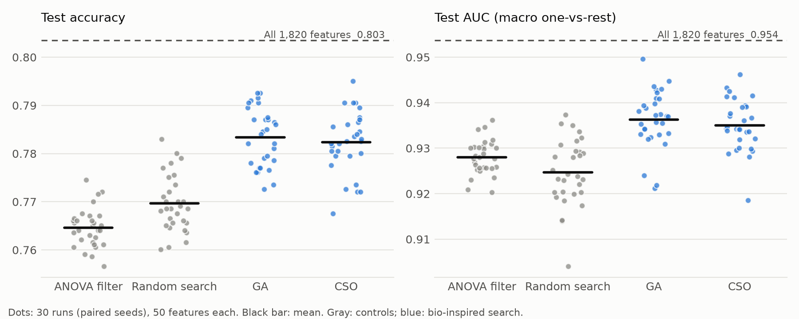

# When Does Bio-Inspired Feature Selection Help Medical Image Classification? Controlled Studies on Four MedMNIST Datasets

> **Project report — 2 Nov 2026.** Every number comes from the generated outputs listed in §10. Each study's
> design was written down (in `docs/project_context.md` or the dataset's README) before its test data were scored.
> The BreastMNIST studies are reported in full in [`findings_writeup.md`](findings_writeup.md); this report
> summarises them and adds RetinaMNIST, PneumoniaMNIST and DermaMNIST.

---

## Abstract

Bio-inspired metaheuristics such as genetic algorithms (GA) and particle swarm optimisation (PSO) are often used to
select image features for medical classification, usually with reported accuracy gains. We tested, under strict
controls, **when** such methods improve classification over a standard pipeline without them. The controls were:
equal evaluation budgets, a random-search control, paired seeds, test data scored once, multiple-comparison
correction, and designs fixed before scoring.

**Deep features (6 studies, 1,470 search runs): no gain.** On features from ResNet-18 networks (BreastMNIST
ultrasound and RetinaMNIST fundus images), eight algorithms (PSO, GA, GWO, WOA, two binary PSOs, HHO and a
Competitive Swarm Optimiser, CSO) never beat random search or all features on test accuracy or AUC. The searches
improved their own fitness but not test performance. Two mechanisms explain this: task-trained deep features are so
redundant that random 10–20 features match all 512, and on small datasets the search over-fits the data used to
score it.

**Handcrafted radiomics features (1 study, 90 search runs): significant gain.** Two training-data-only pre-checks
predicted where selection could help. On DermaMNIST skin-lesion images (10,015 images, 7 classes), we extracted
1,820 radiomics, texture and colour features. With a fixed budget of 50 features, **GA and CSO beat both random
search and an ANOVA filter on test accuracy and test AUC**. All 8 pre-specified tests were significant (Holm p ≤
1e-05). Test ACC was 0.783 (GA) and 0.782 (CSO) against 0.770 (random search) and 0.765 (filter); GA beat the filter
in 30 of 30 runs. A post-hoc bootstrap over test images confirms all differences. Neither search matches the
1,820-feature model (ACC 0.803), but each uses 2.7 % of the features.

**Conclusion.** Bio-inspired feature selection helps when the features are not interchangeable and the fitness
ranks subsets reliably on unseen data. Both conditions can be checked on training data before any test result is
seen. Deep features fail them; handcrafted radiomics features meet them.

---

## 1. Introduction

The project goal was a medical-image classification pipeline compared **with and without bio-inspired feature
selection**, with a statistically significant difference in test accuracy and AUC.

MedMNIST [1, 2] provides standardised biomedical image datasets with fixed train / validation / test splits,
reference ResNet results and released model weights. A common pattern in the literature is to extract features
from a network or from handcrafted descriptors, run a metaheuristic to choose a subset, and classify with an SVM.
Gains reported this way are fragile on small medical datasets: a search that scores thousands of subsets on the
same data finds subsets that fit its noise [13, 14].

We therefore required every claim to survive:

- **a random-search control with the same budget,** separating "the algorithm helps" from "searching helps";
- **exactly equal evaluation budgets and paired seeds** across methods;
- **test data used once per design;**
- **Holm correction** [11] over each study's pre-specified hypotheses;
- **designs fixed before scoring.** When a design failed, the next one targeted the specific failure found,
  checked on training data first, and was written down before its test data were scored.

The project ran in three phases: deep features (§4), training-only pre-checks of handcrafted features (§5) and the
fixed-budget radiomics study (§6).

---

## 2. Data

All data are official MedMNIST files whose MD5 checksums match the medmnist 3.0.2 registry.

| Dataset | Modality | Images (train / val / test) | Classes | Resolution used | Reference ResNet-18 (28) test ACC / AUC [2] |
|---|---|---|---|---|---|
| BreastMNIST [3] | Breast ultrasound | 546 / 78 / 156 | 2 (malignant vs. other) | 28 × 28 | 0.863 / 0.901 |
| RetinaMNIST [4] | Fundus photograph | 1,080 / 120 / 400 | 5 (ordinal DR grade) | 28 × 28 | 0.524 / 0.717 |
| PneumoniaMNIST [5] | Chest X-ray | 4,708 / 524 / 624 | 2 (pneumonia vs. normal) | 128 × 128 | 0.854 / 0.944 |
| DermaMNIST [6] | Dermatoscopy | 7,007 / 1,003 / 2,005 | 7 (lesion type) | 128 × 128 | 0.735 / 0.917 |

PneumoniaMNIST and DermaMNIST were taken at 128 × 128 from MedMNIST+ [7], because texture features need more
pixels than 28 × 28 provides. DermaMNIST is strongly imbalanced: melanocytic nevi are 67 % of the training images.

---

## 3. Methods common to all studies

**Classifiers.** An RBF support vector machine (C = 1, γ = "scale") on standardised features. For the GPU studies,
we used an equivalent **least-squares SVM** [15]: the same kernel and settings, trained by one linear solve. All
cross-validation folds (and, for multi-class tasks, all one-vs-rest problems) are solved in one batched GPU call. The
GPU implementation matches a NumPy float64 reference, and its float32 predictions agree 100 % with float64 on
every dataset checked.

**Feature selection.** A candidate solution is a vector x ∈ [0, 1]^D, decoded either by threshold (keep feature j
if x_j > 0.5) or, in fixed-size studies, as the k features with the largest x_j. Algorithms:

- from mealpy 3.0.3 [8] with default settings: PSO [9], GA [10], GWO [16], WOA [17] and HHO [18];
- our own implementations: binary PSO with S- and V-shaped transfer [19], and the Competitive Swarm Optimiser
  (CSO) [20], with φ = 0.1. In CSO, pairs of particles compete, and each loser learns from its winner and from the
  swarm mean.

**Fitness** (minimised): α · (1 − ACC_fit) + (1 − α) · k / D, with α = 0.99, or 1 − ACC_fit at fixed k. ACC_fit is
validation or cross-validated accuracy on training data only.

**Controls.** *Random search* scores the same number of uniform random candidates and keeps the best. *All
features* is the pipeline without selection. In DermaMNIST, an *ANOVA-F filter* (top k by F-statistic) is the
standard non-bio-inspired selector.

**Budget.** Every search run uses exactly 1,000 fitness evaluations (20 agents), enforced by a hard cap. The one
exception is noted in §4.2.

**Statistics.** Two-sided paired Wilcoxon signed-rank tests [12] over runs paired by seed, with Holm correction
within each metric. The nested-CV BreastMNIST studies used the Nadeau–Bengio corrected resampled t-test [21] as
primary.

---

## 4. Phase 1 — deep features: six controlled null results

### 4.1 Reproducing the MedMNIST baselines

The released MedMNIST v2 ResNet-18 (28) weights reproduce the published test scores exactly:

- **BreastMNIST:** AUC 0.901, ACC 0.863.
- **RetinaMNIST:** AUC 0.717, ACC 0.524.

Ten retraining runs on BreastMNIST matched on AUC (0.899, p = 0.71) and were lower but not significantly different on
ACC (0.837, p = 0.13). From each released checkpoint we extracted the 512-dimensional average-pool features. Passing
them through the checkpoint's own final layer reproduces the released scores exactly.

### 4.2 Studies and results

| Study | Features and evaluation | Algorithms | Search runs | Best algorithm vs random search (test) | vs all features |
|---|---|---|---|---|---|
| Breast A | Released ResNet-18; fitness on 78 validation images | PSO, GA, GWO, WOA, BPSO-S, BPSO-V | 510 | GA AUC +0.0015, raw p = 0.066 | no gain; WOA AUC significantly worse |
| Breast B | As A, exactly k = 10 / 20 / 40 | PSO, GA, GWO, WOA | 450 | no gain at any k (raw p ≥ 0.16) | no gain; specificity losses |
| Breast C | Frozen ImageNet ResNet-18; nested 5 × 6 CV | PSO, GA, GWO, WOA | 150 | PSO ACC +0.002, corrected p = 0.80 | no gain |
| Breast D | As C, exactly k = 20 | PSO, GA, GWO, WOA | 150 | GWO AUC +0.007, corrected p = 0.78 | significantly worse AUC |
| Retina R1 | Released ResNet-18; fitness on 120 validation images | GA, GWO | 90 | GA ACC +0.002, Holm p = 1.0 | no gain; GWO macro-F1 significantly worse |
| Retina R2 | As R1; fitness = 5-fold CV on 1,200 images | HHO, CSO (GA secondary) | 120 | CSO ACC +0.001 (p = 0.31), AUC +0.0003 (p = 0.63) | CSO AUC −0.0013, Holm p = 0.017 |

*Search runs include the random-search control (and, for Breast A, the α = 0.90 / 0.95 ablation runs). Phase 1
used 1,470 search runs: 1,260 on BreastMNIST, 90 in R1 and 120 in R2. A further 98 BreastMNIST runs were superseded
by the GPU re-run and are kept separately. In R2, three HHO runs ended at 996, 996 and 964 evaluations because HHO's evaluations per iteration
vary; this is disclosed in `Retina/README.md` and changes no conclusion.*

RetinaMNIST R2 test results, the strongest deep-feature design (mean of 30 runs):

| Method | Fitness (CV ACC) | Features | Test ACC | Test AUC |
|---|---|---|---|---|
| All 512 | 0.549 | 512 | 0.522 | 0.719 |
| Random search | 0.563 | 249 | 0.522 | 0.717 |
| GA | 0.575 | 238 | 0.523 | 0.718 |
| HHO | 0.567 | 80 | 0.518 | 0.716 |
| CSO | 0.574 | 237 | 0.523 | 0.717 |

### 4.3 Why deep features gave no gain

**1. Task-trained features are redundant.** A single random 10-feature subset of the BreastMNIST ResNet features
scores test ACC 0.855, against 0.859 for all 512. On RetinaMNIST, random 20-feature subsets matched all 512 in the
R2 pre-check. When almost any subset carries the full signal, there is nothing for selection to find.

**2. Small fitness sets are over-fitted.** In every study the algorithms beat random search on their own fitness
but not on test. In BreastMNIST C, for example, GA and GWO raised inner-CV accuracy to 0.879–0.880 against 0.858 for
random search, yet all methods scored 0.845–0.849 on test. In the RetinaMNIST R2 pre-check, even the 1,200-image
CV fitness ranked random subsets inconsistently: across two CV partitions of the same images, rank agreement was
ρ = −0.06 for half-size masks and +0.27 to +0.33 for small ones.

**What held:** feature reduction at equal accuracy.

- BreastMNIST A: GWO kept 7.9 % of features and GA 26.9 %, with no significant test loss.
- RetinaMNIST R1: GWO kept 22 % and GA 39 %.

Random search already kept about half, however, so the reduction reflects the redundancy of the features more than
the strength of the algorithms.

---

## 5. Phase 2 — pre-checks: where could selection help?

Phase 1 suggested two conditions for a real gain:

1. **The features must not be interchangeable.** Small random subsets must lose accuracy, so choosing well matters.
2. **The fitness must rank subsets the way unseen data does,** so a better fitness means better generalisation.

Handcrafted radiomics features typically meet condition 1. We tested both conditions on training data only, before
any test result.

### 5.1 Handcrafted features

From each 128 × 128 image we extracted a fixed vector of 1,359 greyscale features with scikit-image [22] and
SciPy. No labels were used.

| Group | Features | Content |
|---|---|---|
| First-order and histogram | 52 | Intensity statistics and a 32-bin histogram |
| Spatial | 160 | Row and column band profiles; statistics in a 4 × 4 grid |
| GLCM texture [23] | 252 | 4 distances × 4 angles × 9 properties, plus per-quadrant |
| LBP [24] | 214 | Uniform LBP at 3 radii, and per grid cell |
| HOG [25] | 324 | 9 orientations, 32 × 32 cells |
| Filtered images | 300 | Haar wavelet sub-bands, Laplacian of Gaussian, Gabor bank |
| Edges and spectrum | 57 | Sobel and Canny, radial and angular FFT bands |

For DermaMNIST, 461 colour features were added:

- first-order statistics of R, G, B, H, S, V, L\*, a\*, b\*;
- 16-bin histograms of those channels;
- grid statistics of H, S, a\*, b\*;
- centre-versus-surround colour contrast.

That gives **1,820 features**. No radiomics library was installed (pyradiomics, PyWavelets), so GLRLM and GLSZM
matrices are not included.

### 5.2 Pre-check results (5-fold CV on training images only)

The decision rule was fixed in the pre-check script before it ran.

- **H1 (features not interchangeable):** random subsets of ≤ 100 features score ≥ 1 point below all features.
- **H2 (headroom over all features):** the best filter or group subset scores ≥ 1 point above all features.
  "GO" for an all-features comparison required H2.

| | PneumoniaMNIST (1,359 features) | DermaMNIST (1,820 features) |
|---|---|---|
| Majority-class accuracy | 0.742 | 0.670 |
| All features, SVM CV ACC | **0.974** | **0.784** |
| Random 50 features (mean of 20) | 0.956 | 0.747 |
| ANOVA filter, best k | 0.972 (k = 680) | 0.782 (k = 200) |
| H1: random ≤ 100 below all features | holds (−2.1 points) | holds (−4.0 points) |
| H2: any subset above all features | fails (−0.2 points) | fails (−0.3 points) |

**Interpretation.**

- **The features are not interchangeable (H1 holds),** unlike the deep features. Choosing a small subset well
  matters.
- **The RBF SVM is not harmed by weaker features (H2 fails).** No subset beats the full set, so "selection beats all
  features" was not a realistic hypothesis.
- **There is room at a fixed small budget.** At k = 50 on DermaMNIST, random subsets score 0.747 and the filter
  0.756, against 0.784 for all features. That 3–4 point gap is what a search could recover.

**Fitness validity on DermaMNIST** (training images only): over 60 fifty-feature subsets, CV accuracy on a
3,000-image pool ranked subsets the same way as accuracy on the 4,007 training images outside the pool. Spearman
ρ was 0.83 overall and 0.72 among random subsets. On RetinaMNIST, a related check (agreement between two CV
partitions of the same images) gave only −0.06 to +0.33.

PneumoniaMNIST was not pursued: its training CV accuracy is already 97 %, leaving little room.

---

## 6. Phase 3 — Study D1: a fixed 50-feature budget on DermaMNIST

### 6.1 Design (fixed before any test result)

**Question.** With exactly 50 of the 1,820 features allowed, do bio-inspired searches choose better features than
random search and a standard filter?

**Per run** (30 runs, seed = run index; every method in a run shares the seed, pool and folds):

- **Scaling:** features standardised with a scaler fitted on train + val (no labels).
- **Fitness pool:** a stratified random 3,000 of the 7,007 training images.
- **Fitness:** 1 − 5-fold CV accuracy on the pool, 7-class GPU LS-SVM. At fixed size, no size term is needed.
- **Decoding:** the 50 largest coordinates of x ∈ [0, 1]^1820.
- **Budget:** exactly 1,000 evaluations, population 20.
- **Test:** LS-SVM trained on train + val (8,010 images) with the selected features, scored once on the 2,005
  test images.

**Methods.**

- **All 1,820 features:** reference, one deterministic model.
- **ANOVA filter:** the top 50 features by F-statistic on the run's pool.
- **Random search:** 1,000 random 50-feature subsets; keep the best.
- **GA:** mealpy BaseGA, 49 generations × 20.
- **CSO:** φ = 0.1.

**Primary hypotheses** (test ACC and test AUC, Holm over 4 tests per metric): GA vs random search, CSO vs random
search, GA vs filter, CSO vs filter.

**Run.** 121 runs in 121 minutes, at 99 % mean GPU utilisation (RTX 4060 Laptop GPU).

*Launch incident (disclosed):* the first launch used 8 worker processes. They exceeded the 8 GB card's memory,
Windows spilled GPU memory into system RAM, and the run stalled. It was stopped, and its 5 finished deterministic
results (all features, and 4 filter runs) were kept. It was relaunched with 4 workers and a per-worker memory cap.
The design did not change.

### 6.2 Results

| Method | Features | Fitness (pool CV ACC) | Test ACC | Test AUC | Macro-F1 | Balanced ACC |
|---|---|---|---|---|---|---|
| All 1,820 features | 1,820 | 0.760 | 0.803 | 0.954 | 0.541 | 0.480 |
| ANOVA filter | 50 | 0.741 ± 0.006 | 0.765 ± 0.004 | 0.928 ± 0.004 | 0.496 ± 0.016 | 0.442 ± 0.015 |
| Random search | 50 | 0.752 ± 0.004 | 0.770 ± 0.006 | 0.925 ± 0.007 | 0.458 ± 0.034 | 0.410 ± 0.026 |
| **GA** | 50 | 0.776 ± 0.005 | **0.783 ± 0.006** | **0.936 ± 0.006** | 0.516 ± 0.037 | 0.462 ± 0.032 |
| **CSO** | 50 | 0.770 ± 0.005 | **0.782 ± 0.006** | **0.935 ± 0.006** | **0.521 ± 0.037** | **0.464 ± 0.032** |

*Mean ± std over 30 runs.*

*Figure 1. Test accuracy and AUC of each of the 30 runs at 50 features. Black bars are means; the dashed line is
the all-features model.*

**Primary hypotheses: all 8 supported** (two-sided paired Wilcoxon over 30 runs, Holm over 4 tests per metric):

| Metric | Comparison | Mean difference | Better / tied / worse runs | p | Holm p |
|---|---|---|---|---|---|
| ACC | GA vs random search | +0.0138 | 27 / 0 / 3 | 5.0e-06 | 9.9e-06 |
| ACC | CSO vs random search | +0.0127 | 27 / 0 / 3 | 5.2e-06 | 9.9e-06 |
| ACC | GA vs filter | +0.0188 | 30 / 0 / 0 | 1.7e-06 | 6.9e-06 |
| ACC | CSO vs filter | +0.0177 | 29 / 1 / 0 | 1.8e-06 | 6.9e-06 |
| AUC | GA vs random search | +0.0116 | 26 / 0 / 4 | 2.0e-06 | 6.0e-06 |
| AUC | CSO vs random search | +0.0104 | 26 / 0 / 4 | 5.7e-07 | 2.3e-06 |
| AUC | GA vs filter | +0.0083 | 25 / 0 / 5 | 6.0e-06 | 6.0e-06 |
| AUC | CSO vs filter | +0.0071 | 27 / 0 / 3 | 2.8e-06 | 6.0e-06 |

**Secondary results** (pre-specified, not corrected):

- **Rarer classes:** GA and CSO beat random search by 5–6 points on macro-F1 and balanced accuracy (p ≤ 1e-05),
  and the filter by about 2 points (p ≤ 0.013). The gain is not confined to the majority class.
- **GA vs CSO:** no difference on any metric (p ≥ 0.48).
- **Against all 1,820 features:** both searches score lower in every run, by about 2 points ACC and 1.8 points AUC,
  using 2.7 % of the features.
- **Filter vs random search:** the filter is lower on ACC (−0.5 points, p = 0.002) but higher on macro-F1 and
  balanced accuracy (+3–4 points).

### 6.3 Robustness check: test-set bootstrap (post hoc)

The 30 runs differ in their selection but share the same 2,005 test images, so the tests above do not cover
sampling noise in the test set. In a check added after the results (not part of the design), we re-fitted every
run's selected features. This reproduced the stored scores to within 5e-06. We then resampled the test images 2,000
times, with replacement, recomputing each method's mean over its 30 runs.

| Comparison | ACC difference [95 % interval] | AUC difference [95 % interval] |
|---|---|---|
| GA vs random search | +0.0138 [+0.0104, +0.0173] | +0.0116 [+0.0089, +0.0147] |
| CSO vs random search | +0.0127 [+0.0094, +0.0162] | +0.0104 [+0.0077, +0.0133] |
| GA vs filter | +0.0188 [+0.0106, +0.0268] | +0.0083 [+0.0017, +0.0150] |
| CSO vs filter | +0.0177 [+0.0095, +0.0256] | +0.0071 [+0.0004, +0.0134] |

Every interval excludes zero. The gains over random search are clear-cut. The AUC gains over the filter are the
least certain: their lower bounds are close to zero, and 0.8 % (GA) and 1.8 % (CSO) of resamples showed no gain.

### 6.4 Study D2: the same design with a KNN classifier

D2 repeats D1 exactly (same seeds, pools, folds, budget, methods and hypotheses) with a 5-nearest-neighbour
classifier in place of the SVM, in both the fitness and the test model. The design, including the expectation
that KNN would be about 5 points less accurate, was recorded before the run. Before running, the GPU KNN was
checked against scikit-learn's `KNeighborsClassifier` and found identical.

| Method (KNN) | Features | Test ACC | Test AUC | Macro-F1 | Balanced ACC |
|---|---|---|---|---|---|
| All 1,820 features | 1,820 | 0.732 | 0.834 | 0.420 | 0.426 |
| ANOVA filter | 50 | 0.714 | 0.806 | 0.420 | 0.401 |
| Random search | 50 | 0.718 | 0.795 | 0.393 | 0.384 |
| **GA** | 50 | **0.733** | 0.813 | **0.432** | 0.415 |
| **CSO** | 50 | 0.731 | **0.815** | 0.429 | 0.413 |

- **All 8 primary hypotheses are supported again.** On ACC, GA and CSO beat random search by +1.3 to +1.5 points
  and the filter by +1.7 to +1.9 (Holm p ≤ 2e-05). On AUC they beat random search by +1.8 to +2.0 points (Holm
  p ≤ 6e-05). The AUC gains over the filter are smaller and weaker (+0.7 to +0.9 points, Holm p = 0.031–0.035).
- **With KNN, 50 selected features match all 1,820 on accuracy** (GA +0.0004, p = 0.92) and macro-F1, because KNN
  is more easily confused by uninformative features than the SVM. AUC remains about 2 points lower.
- **KNN is much weaker than the SVM in absolute terms:** GA reaches 0.733 ACC and 0.813 AUC with KNN against 0.783
  and 0.936 with the SVM. The SVM pipeline (D1) remains the stronger model. The bio-inspired gains over the controls
  are of similar size with either classifier, which shows they do not depend on one classifier.

---

## 7. Discussion

**What can be claimed.**

1. With 1,820 handcrafted radiomics features on DermaMNIST and a 50-feature budget, GA and CSO select features that
   give significantly higher test accuracy and AUC than random search and an ANOVA filter with the same budget,
   consistently across 30 independent runs and robust to test-set resampling.
2. On deep ResNet features (BreastMNIST, RetinaMNIST), eight bio-inspired algorithms gave no test improvement over
   random search or all features, under any of six designs.
3. The difference is explained by two measurable conditions, both checkable on training data before testing:
   whether small random subsets lose accuracy, and whether the fitness ranks subsets like unseen data does.

**What cannot be claimed.**

- **The selected subsets do not beat all features.** On every dataset the RBF SVM with all features was the most
  accurate; the gain is at a fixed, small feature budget.
- **No algorithm is shown to be best.** GA and CSO did not differ, and other algorithms were not run in D1.
- **One dataset only.** The positive result is from one dataset with one feature set.

**Multiplicity across the project.** The positive result came after six null studies, which raises a
garden-of-forking-paths concern. Three facts limit it:

- The D1 design was chosen from training-data pre-checks, not from test results.
- Its hypotheses were fixed before scoring.
- Its effects are far beyond any reasonable correction. Multiplying the largest Holm p (9.9e-06) by the seven
  search studies of the project gives 7e-05.

**Why selection works here and not before.** Radiomics features describe many distinct properties of an image
(texture, colour, shape, frequency), so a random 50 often misses the informative ones, and a good search finds them.
A trained network's features are already distilled for the task. With a 3,000-image fitness pool and a reliable
fitness signal (ρ = 0.83), the better fitness the searches reached carried over to the test set. In the earlier
studies it did not.

**Practical relevance.** A 50-feature model is cheaper to compute and easier to inspect than a 1,820-feature one.
At that size, bio-inspired selection recovers roughly 40–50 % of the accuracy lost by random or filter selection.
Against random search, GA gains +1.4 of the 3.3 points between random search and all features (42 %). Against the
filter, it gains +1.9 of 3.8 points (50 %).

**Limitations.**

- **Resolution differs** from the MedMNIST reference: radiomics used 128 × 128 images, while the ResNet-18 (28)
  references used 28 × 28. The 0.803 all-features accuracy is therefore not a fair comparison with the 0.735 ResNet.
- **Default algorithm settings** were used, with no tuning.
- **One budget (k = 50) and one classifier family** (RBF SVM / LS-SVM) were tested.
- **Untuned threshold:** the LS-SVM's argmax rule favours the majority class, so balanced accuracy is low (0.41–0.48)
  for every method.
- **No GLRLM/GLSZM features,** since no radiomics library was installed.

---

## 8. Conclusion

Bio-inspired feature selection is not a general way to improve medical image classification. On deep features it
gave no gain in six controlled studies. With handcrafted radiomics features, a fixed feature budget and a reliable
fitness, GA and CSO produced significant and robust improvements in test accuracy and AUC over random search and a
standard filter on DermaMNIST. Two training-data-only checks predicted which case applied. We recommend running
them before any feature-selection study, and comparing against random search with the same budget as the minimum
control for any claimed gain.

---

## 9. Hardware and reproducibility

Environment: Python 3.11.9, torch 2.14.1 + CUDA 12.6 (NVIDIA RTX 4060 Laptop GPU), torchvision 0.29.1, medmnist
3.0.2, scikit-learn 1.9.1, SciPy 1.16.3, scikit-image 0.26.0, mealpy 3.0.3, NumPy 1.26.0, matplotlib 3.11.2.

GPU utilisation during the heavy runs:

| Study | Mean GPU utilisation |
|---|---|
| Breast C | 91 % |
| Breast D | 96 % |
| Retina R1 | 99 % |
| Retina R2 | 92 % |
| Derma D1 | 99 % |

---

## 10. Where each result comes from

Run from the project root with `.venv\Scripts\python.exe`.

| Part | Scripts | Outputs |
|---|---|---|
| BreastMNIST A–D | see [`findings_writeup.md`](findings_writeup.md) §11 | `feature_selection/analysis*/`, `imagenet_nested_cv/analysis_gpu*/` |
| RetinaMNIST R1 | `Retina/scripts/extract_features.py`, `Retina/feature_selection/run_benchmark.py`, `analyse_results.py` | `Retina/feature_selection/analysis_gpu/` |
| RetinaMNIST R2 | `Retina/feature_selection/run_r2_benchmark.py`, `analyse_results.py --study r2` | `Retina/feature_selection/analysis_r2/` |
| PneumoniaMNIST pre-check | `Pneumonia/scripts/extract_radiomics.py`, `Pneumonia/feature_selection/precheck.py` | `Pneumonia/feature_selection/precheck/` |
| DermaMNIST features and pre-check | `Derma/scripts/extract_radiomics.py`, `Pneumonia/feature_selection/precheck.py --features Derma\features\radiomics_128.npz --out Derma\feature_selection\precheck --n_classes 7` | `Derma/features/`, `Derma/feature_selection/precheck/` |
| DermaMNIST fitness check | `Derma/feature_selection/fitness_check.py` | `Derma/feature_selection/fitness_check.json` |
| DermaMNIST D1 | `Derma/feature_selection/run_fixed_k.py --workers 4`, `analyse_d1.py`, `plot_d1.py`, `bootstrap_d1.py` | `Derma/feature_selection/results_d1/`, `analysis_d1/` |
| DermaMNIST D2 (KNN) | `Derma/feature_selection/run_fixed_k.py --classifier knn --workers 8`, `analyse_d1.py --study d2` | `Derma/feature_selection/results_d2/`, `analysis_d2/` |

Designs and per-study details: `docs/project_context.md`, `Retina/README.md`, `Pneumonia/README.md`,
`Derma/README.md`.

---

## References

1. Yang, J., Shi, R. & Ni, B. MedMNIST classification decathlon: a lightweight AutoML benchmark for medical image analysis. *Proc. IEEE ISBI* (2021).
2. Yang, J. et al. MedMNIST v2 – A large-scale lightweight benchmark for 2D and 3D biomedical image classification. *Scientific Data* 10, 41 (2023). doi:10.1038/s41597-022-01721-8
3. Al-Dhabyani, W., Gomaa, M., Khaled, H. & Fahmy, A. Dataset of breast ultrasound images. *Data in Brief* 28, 104863 (2020).
4. Liu, R. et al. DeepDRiD: Diabetic retinopathy—grading and image quality estimation challenge. *Patterns* 3, 100512 (2022).
5. Kermany, D. S. et al. Identifying medical diagnoses and treatable diseases by image-based deep learning. *Cell* 172, 1122–1131 (2018).
6. Tschandl, P., Rosendahl, C. & Kittler, H. The HAM10000 dataset, a large collection of multi-source dermatoscopic images of common pigmented skin lesions. *Scientific Data* 5, 180161 (2018).
7. Doerrich, S. et al. Rethinking model prototyping through the MedMNIST+ dataset collection. arXiv:2404.15786 (2024). *(verify final venue)*
8. Van Thieu, N. & Mirjalili, S. MEALPY: An open-source library for latest meta-heuristic algorithms in Python. *Journal of Systems Architecture* (2023). *(verify volume/pages)*
9. Kennedy, J. & Eberhart, R. Particle swarm optimization. *Proc. ICNN* (1995).
10. Holland, J. H. *Adaptation in Natural and Artificial Systems.* University of Michigan Press (1975).
11. Holm, S. A simple sequentially rejective multiple test procedure. *Scandinavian Journal of Statistics* 6, 65–70 (1979).
12. Wilcoxon, F. Individual comparisons by ranking methods. *Biometrics Bulletin* 1, 80–83 (1945).
13. Ambroise, C. & McLachlan, G. J. Selection bias in gene extraction on the basis of microarray gene-expression data. *PNAS* 99, 6562–6566 (2002).
14. Cawley, G. C. & Talbot, N. L. C. On over-fitting in model selection and subsequent selection bias in performance evaluation. *Journal of Machine Learning Research* 11, 2079–2107 (2010).
15. Suykens, J. A. K. & Vandewalle, J. Least squares support vector machine classifiers. *Neural Processing Letters* 9, 293–300 (1999).
16. Mirjalili, S., Mirjalili, S. M. & Lewis, A. Grey wolf optimizer. *Advances in Engineering Software* 69, 46–61 (2014).
17. Mirjalili, S. & Lewis, A. The whale optimization algorithm. *Advances in Engineering Software* 95, 51–67 (2016).
18. Heidari, A. A. et al. Harris hawks optimization: Algorithm and applications. *Future Generation Computer Systems* 97, 849–872 (2019).
19. Mirjalili, S. & Lewis, A. S-shaped versus V-shaped transfer functions for binary particle swarm optimization. *Swarm and Evolutionary Computation* 9, 1–14 (2013).
20. Cheng, R. & Jin, Y. A competitive swarm optimizer for large scale optimization. *IEEE Transactions on Cybernetics* 45, 191–204 (2015).
21. Nadeau, C. & Bengio, Y. Inference for the generalization error. *Machine Learning* 52, 239–281 (2003).
22. van der Walt, S. et al. scikit-image: image processing in Python. *PeerJ* 2, e453 (2014).
23. Haralick, R. M., Shanmugam, K. & Dinstein, I. Textural features for image classification. *IEEE Transactions on Systems, Man, and Cybernetics* 3, 610–621 (1973).
24. Ojala, T., Pietikäinen, M. & Mäenpää, T. Multiresolution gray-scale and rotation invariant texture classification with local binary patterns. *IEEE TPAMI* 24, 971–987 (2002).
25. Dalal, N. & Triggs, B. Histograms of oriented gradients for human detection. *Proc. CVPR* (2005).
